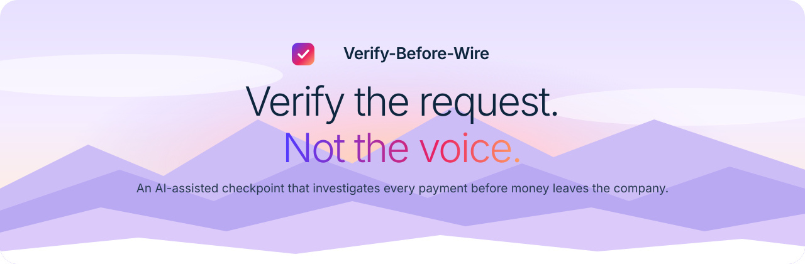
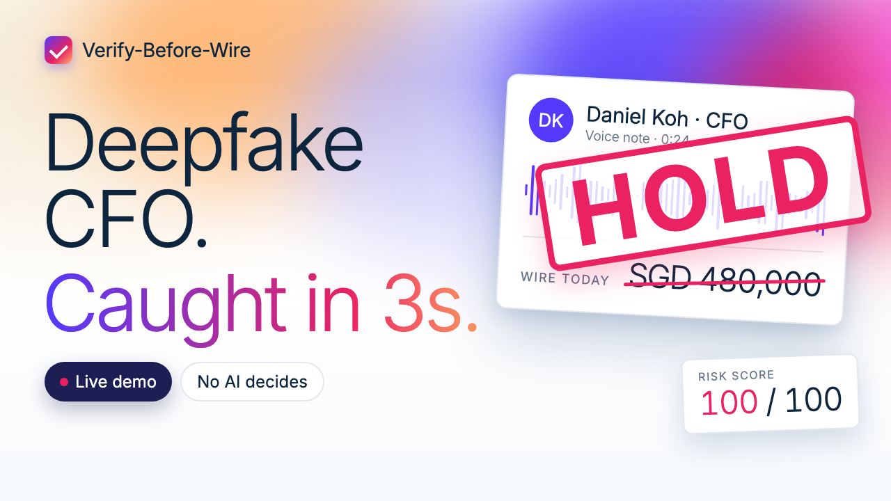
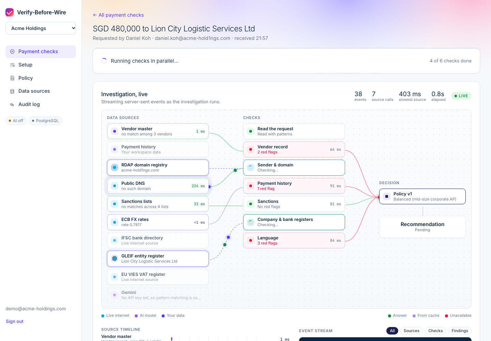
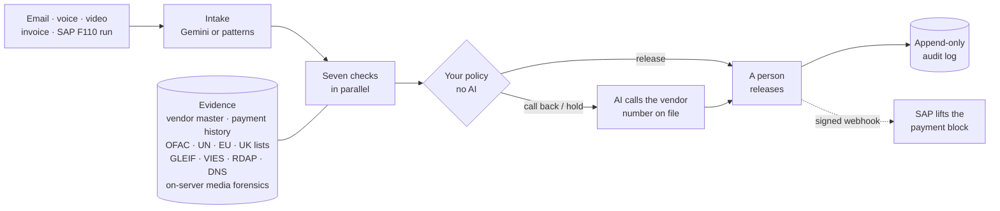
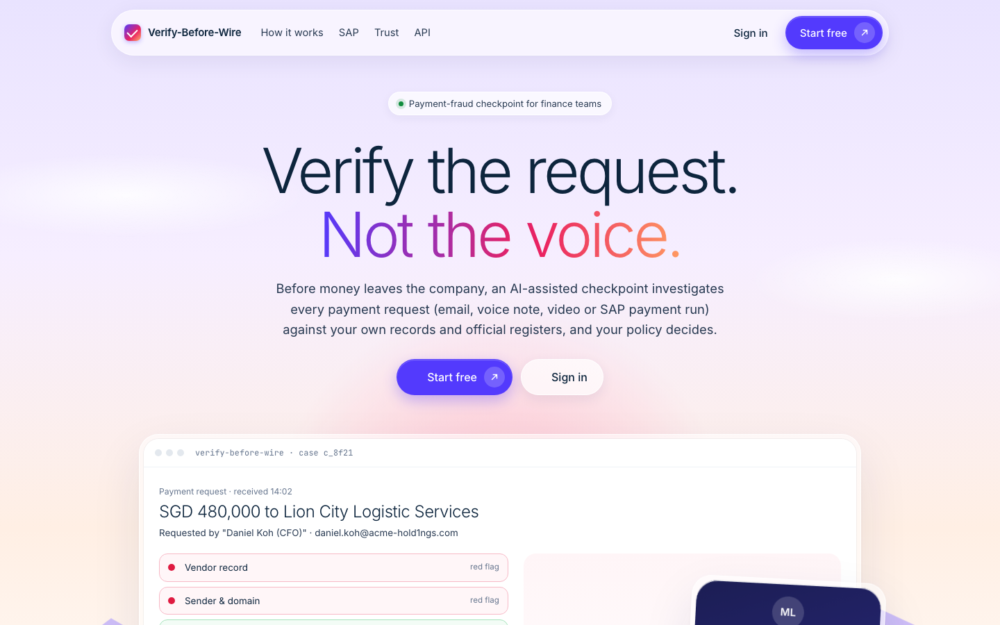
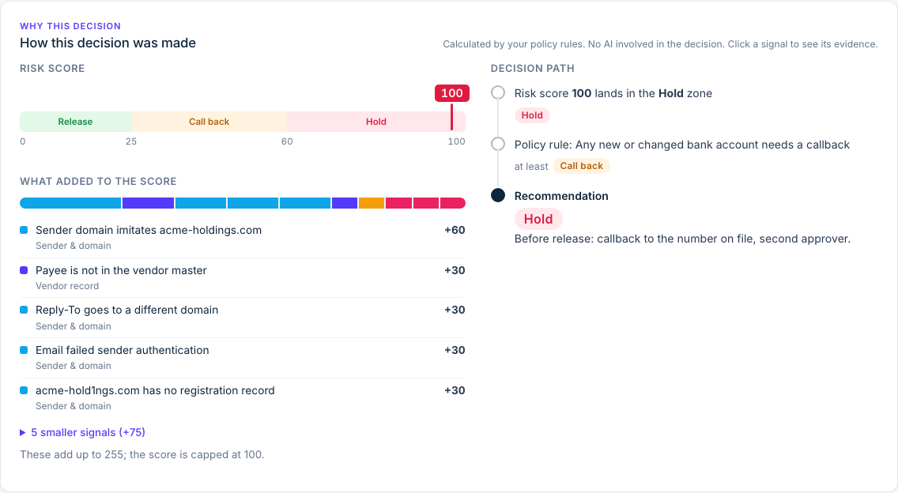
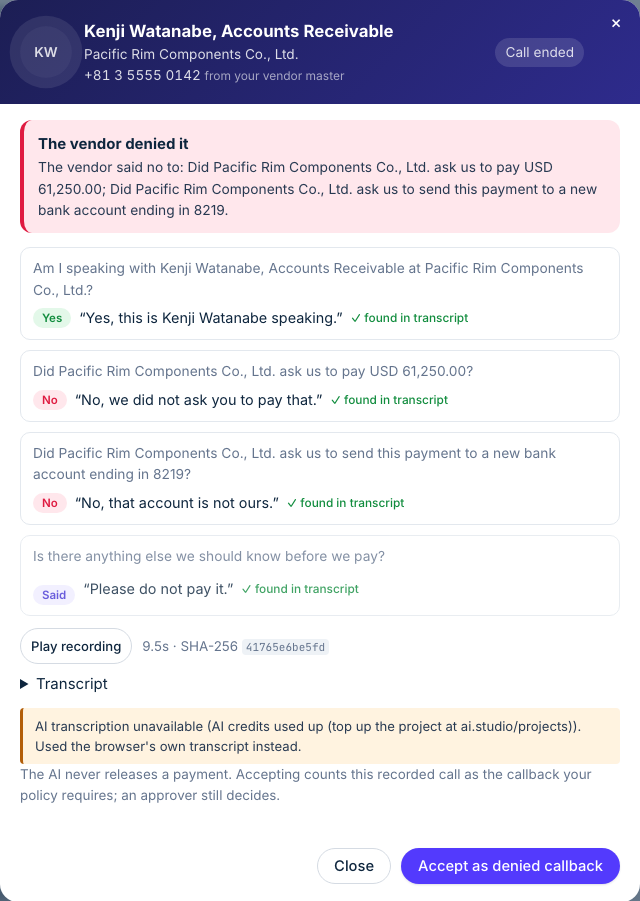
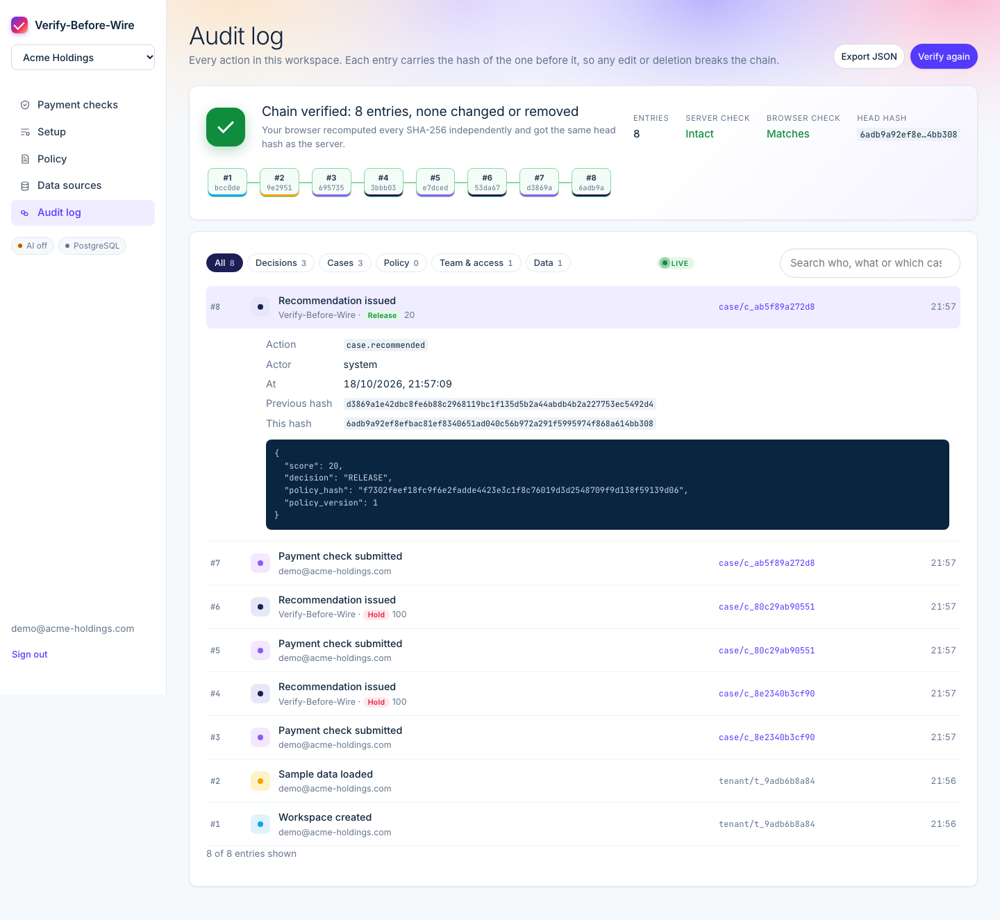
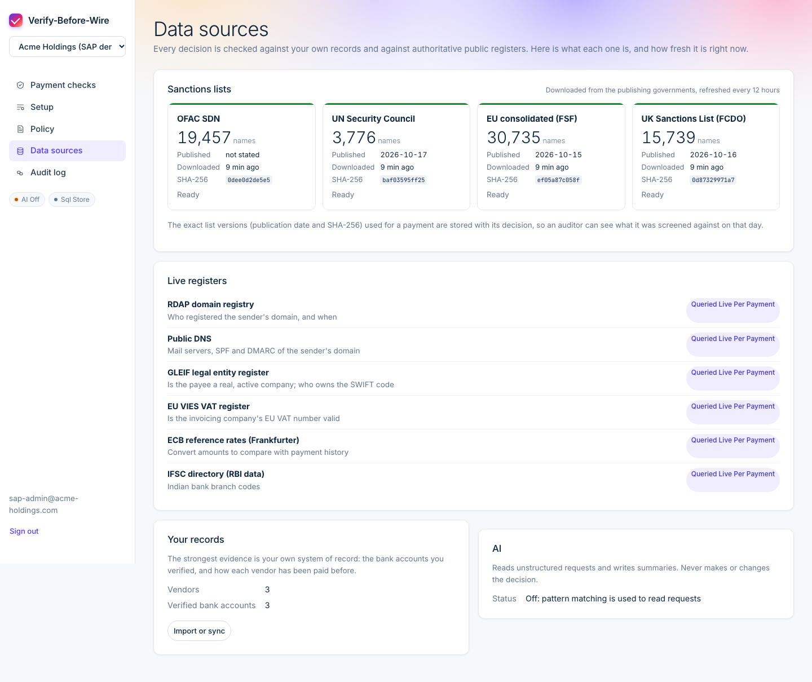
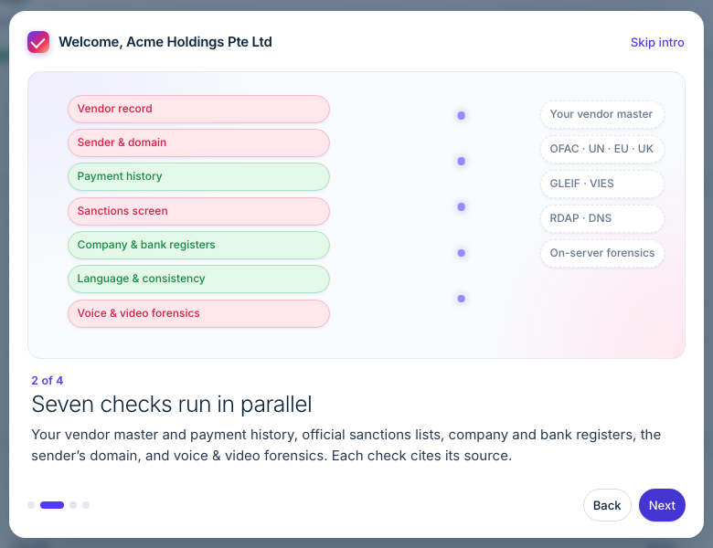

<p align="center">
  
</p>

<p align="center">
  <a href="#run-it"></a>
  
  
  
  
  
</p>

<p align="center">
  <a href="docs/how-it-works.md">How it works</a> ·
  <a href="docs/demo.md">3-minute demo</a> ·
  <a href="docs/sap-integration.md">SAP plug-in</a> ·
  <a href="docs/trust.md">Trust</a> ·
  <a href="docs/production.md">Production</a>
</p>

<p align="center">
  <a href="docs/assets/verify-before-wire-demo.mp4"></a><br>
  <sub><b><a href="docs/assets/verify-before-wire-demo.mp4">▶ Watch the demo</a></b> · 3½ minutes · the real app, end to end</sub>
</p>

<br>

Finance teams are tricked into paying fraudsters by emails from a "CFO", cloned voices, fake video
calls and invoices with changed bank details. Detecting a perfect deepfake is an arms race.
**Verify-Before-Wire doesn't try to win it. It checks the request against facts**: your vendor
master, your payment history, official sanctions lists and company registers, and the voice or video
file itself. Your own policy decides whether the money may go.

<p align="center">
  
</p>

## Run it

```bash
docker compose up --build        # PostgreSQL + the app  →  http://localhost:8080
```

Choose **Start free**, sign in with any email, create a workspace, preview and add the sample data,
and run the **CFO voice note** sample. Optionally `export GEMINI_API_KEY=…` first; without it every
check still runs and decisions are identical. Presenting? Follow the **[3-minute demo script](docs/demo.md)**.

## What it does

<table>
<tr>
<td width="33%" valign="top">

**Investigates, live**<br>
<sub>Seven checks run in parallel. Every lookup to every data source streams to the page as it happens, with real latency, cache hits and failures.</sub>

</td>
<td width="33%" valign="top">

**Explains every decision**<br>
<sub>The score build-up, each signal linked to its evidence, and the policy path. Deterministic: the AI reads and summarises, it never decides.</sub>

</td>
<td width="33%" valign="top">

**Catches deepfakes cheaply**<br>
<sub>Voice notes and videos are measured on the server: exact digital silence, a still picture under a voice-over, generator metadata.</sub>

</td>
</tr>
<tr>
<td valign="top">

**Calls the real vendor**<br>
<sub>On a hold, an AI agent calls the number in your vendor master, records the answers, and Gemini transcribes them. An answer counts only if it's quoted from the transcript.</sub>

</td>
<td valign="top">

**Plugs into SAP**<br>
<sub>Check a whole F110 payment run in one call. SAP keeps the payment block until a person releases; signed webhooks report back.</sub>

</td>
<td valign="top">

**Can't be rewritten**<br>
<sub>A hash-chained audit log your browser can verify, enforced again by PostgreSQL. Each decision stores the policy hash and the sanctions-list versions it used.</sub>

</td>
</tr>
</table>

## How it fits together



<sub>Step by step, with what Gemini does and never does: **[How it works](docs/how-it-works.md)**.</sub>

## By the numbers

| | |
|:--|:--|
| **~100 ms** | to check one SAP payment end to end (PostgreSQL, seven checks, policy, audit) |
| **~23 checks/s** | from a single process at 30 concurrent, audit chain intact after 600+ concurrent writes |
| **~70,000** | sanctioned names across the official OFAC, UN, EU and UK lists, refreshed every 12 hours |
| **122 tests** | on PostgreSQL 16: API, SAP integration, AI calls, media forensics, webhooks, worker, concurrency, security, fuzzing |
| **100% / ≤10%** | frauds stopped / false alarms in the evaluation suite, enforced in CI |
| **0** | payments released by AI. Your policy decides, and a person releases. |

<sub>Measured with `make bench` and `make eval` on a laptop (Apple Silicon, PostgreSQL in Docker).</sub>

## A look inside

<table>
<tr>
<td width="50%"><br><sub><b>Landing page</b> · parallax hero and a live product mockup</sub></td>
<td width="50%"><br><sub><b>Why this decision</b> · every risk point, linked to its evidence</sub></td>
</tr>
<tr>
<td><br><sub><b>AI verification call</b> · each answer tied to the vendor's own words</sub></td>
<td><br><sub><b>Audit log</b> · SHA-256 chain re-verified in your browser</sub></td>
</tr>
<tr>
<td><br><sub><b>Data sources</b> · official lists with publication date and fingerprint</sub></td>
<td><br><sub><b>Onboarding</b> · an animated film, then a guided tour</sub></td>
</tr>
</table>

## Documentation

| | |
|:--|:--|
| [How it works](docs/how-it-works.md) | The system in plain words: one payment step by step, the seven checks, policy, roles, code map |
| [3-minute demo](docs/demo.md) | A presenter script with what to click, what to say, and what to do if something fails |
| [SAP plug-in](docs/sap-integration.md) | Payment block, F110, BTP Integration Suite, field mapping, webhook verification, ABAP sketch |
| [Trust](docs/trust.md) | Why a finance team can rely on the decisions, which data sources back them, and current limits |
| [Production](docs/production.md) | Architecture, database, scaling, monitoring and the release checklist |
| [Firebase & Gemini](docs/firebase-setup.md) | Firebase Authentication, Firestore, Gemini (AI Studio or Vertex), and graceful degradation |
| [API reference](http://localhost:8080/docs) | Interactive OpenAPI docs of the running app |

## For developers

<details>
<summary><b>Local development</b></summary>

<br>

```bash
make setup        # Python 3.12 venv, dependencies, demo files
make db           # PostgreSQL 16 in Docker on 127.0.0.1:5433
make dev          # the app with hot reload on http://localhost:8080
make help         # everything else
```

Create `backend/.env` from `backend/.env.example`. The defaults give PostgreSQL, files on disk,
development sign-in and the sample cases. The first start downloads the official sanctions lists
(about 70 MB) into `backend/data/sanctions`. The voice and video checks need `ffmpeg` on the `PATH`;
the Docker image includes it.

Without Docker, set `STORE_BACKEND=memory` and `BLOB_BACKEND=memory`; data then lasts until restart.

</details>

<details>
<summary><b>Tests and quality</b></summary>

<br>

```bash
make test         # 121 tests on memory + SQLite
make test-pg      # the full suite on PostgreSQL, including the append-only audit trigger
make lint         # ruff + bandit
make eval         # fails if a fraud slips through or false alarms exceed 10%
make bench        # 300 checks, 30 in flight, through the real HTTP API
make check        # everything CI runs
```

CI also runs pip-audit, gitleaks, Trivy and CodeQL, and applies, rolls back and re-applies the
database migrations with a schema-drift check.

</details>

<details>
<summary><b>Configuration</b></summary>

<br>

Platform settings are environment variables (`backend/app/config.py`); each company manages its own
policy, team and data in the app. The ones that matter most:

| Variable | Purpose |
|:--|:--|
| `STORE_BACKEND`, `DATABASE_URL` | `sql` (PostgreSQL), `firestore` or `memory` |
| `AUTH_MODE` | `firebase` in production, `dev` locally |
| `GEMINI_MODE`, `GEMINI_API_KEY` / `GEMINI_PROJECT` | AI Studio key, or Vertex AI in your own project |
| `SANCTIONS_LISTS`, `SANCTIONS_REFRESH_HOURS` | Which official lists, and how often to refresh them |
| `WORKER_ENABLED`, `WORKER_CONCURRENCY` | Background worker in-process, or as separate replicas |
| `TWILIO_*`, `PUBLIC_BASE_URL` | Real phone lines for AI verification calls (optional) |

Firebase and Gemini, step by step: [docs/firebase-setup.md](docs/firebase-setup.md). Check a setup
with `python backend/scripts/firebase_check.py`.

</details>

<details>
<summary><b>Integration API</b></summary>

<br>

SAP and other ERPs send structured payments (no documents, no AI):

```bash
curl -X POST "$URL/api/t/$WORKSPACE/erp/payment-runs?wait=30" \
  -H "Authorization: Bearer $VBW_API_KEY" -H "Content-Type: application/json" \
  -d @f110_run.json
```

Documents (emails, voice notes, videos, invoices) use the upload endpoint:

```bash
curl -X POST "$URL/api/t/$WORKSPACE/checks" \
  -H "Authorization: Bearer $VBW_API_KEY" -H "Idempotency-Key: payment-48213" \
  -F "files=@request.eml" -F "external_ref=PAY-48213"
```

Results come back inline or as signed webhooks (`VBW-Signature`, HMAC-SHA256, retried for about
4 hours). Only `workflow.state == "released"` means the money may go. Field mapping and the SAP
flow: [docs/sap-integration.md](docs/sap-integration.md). Try it end to end: `make sap-demo`.

</details>

<details>
<summary><b>Deployment</b></summary>

<br>

- **Google Cloud Run + Firebase:** `PROJECT_ID=… FIREBASE_API_KEY=… REGION=asia-southeast1 ./deploy.sh`
- **Any VM, AWS or Azure:** `deploy/docker-compose.yml` runs PostgreSQL, a migration job, the app
  and scalable workers. Configure from `deploy/vbw.env.example`.
- **Kubernetes / SAP BTP Kyma:** the same image. Run `alembic upgrade head` as a release step and
  `python -m app.worker` for dedicated workers.

Sizing, monitoring (`/healthz`, `/readyz`, `/metrics`) and the release checklist:
[docs/production.md](docs/production.md).

</details>

<details>
<summary><b>Repository layout</b></summary>

<br>

```
backend/
  app/              FastAPI app: orchestrator, seven checks (agents/), policy, workflow,
                    data sources, media forensics, AI calls, SAP API, webhooks, worker, stores
  migrations/       Alembic migrations (PostgreSQL schema, append-only audit triggers)
  static/           Web app, landing page, onboarding tour, call screen (no build step)
  scripts/          Demo data, SAP simulator, load test, evaluation, setup checker
  tests/            122 tests
demo/               Sample cases: emails, voice note, video message, transcripts
deploy/             Production compose file and environment template
docs/               Guides, screenshots and the banner
DESIGN.md           Design tokens and principles for the UI
```

</details>

<br>

<p align="center">
  <sub><b>Verify before you wire.</b> We verify the request, not the voice.</sub>
</p>
